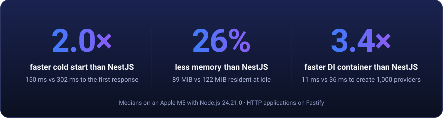
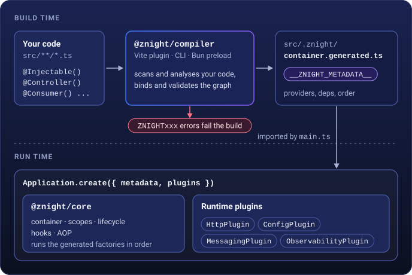

<p align="center">
  
</p>

<p align="center">
  <strong>The TypeScript backend framework whose dependency injection is compiled, not reflected.</strong>
</p>

<p align="center">
  Write services and controllers the NestJS way. A compiler checks the wiring at build time and
  generates the container: no <code>reflect-metadata</code>, no modules, no wiring surprises at boot.
</p>

<p align="center">
  <a href="./LICENSE"></a>
  
  
  
</p>

<p align="center">
  <a href="#quick-start">Quick start</a> ·
  <a href="#a-30-second-tour">Tour</a> ·
  <a href="#getting-started">Getting started</a> ·
  <a href="#packages">Packages</a> ·
  <a href="#examples">Examples</a> ·
  <a href="./docs/benchmarks.md">Benchmarks</a> ·
  <a href="#documentation">Documentation</a> ·
  <a href="./CONTRIBUTING.md">Contributing</a>
</p>

---

Znight is a backend framework for TypeScript in the spirit of NestJS and Spring Boot: services,
controllers, message consumers and scheduled jobs are classes, and a container wires them together.
The difference is _when_ the wiring happens. A compiler (a Vite plugin, also run by the CLI and a Bun
preload) reads your sources, binds every constructor parameter to a provider, validates the whole
graph and generates a plain TypeScript module. At runtime, the container only calls the generated
factories, in an order computed at build time. It is the approach of [Micronaut](https://micronaut.io)
and [Dagger](https://dagger.dev), brought to TypeScript.

<p align="center">
  <a href="./docs/benchmarks.md"></a>
</p>

<p align="center">
  <sub>Medians of 30 runs on an Apple M5 with Node.js 24, HTTP applications on Fastify. Under load, NestJS still
  serves more requests per second on Node.js: the <a href="./docs/benchmarks.md">benchmarks page</a> has every
  result and how to reproduce them.</sub>
</p>

## Quick start

```sh
npx @znight/cli new my-service        # npm
pnpm dlx @znight/cli new my-service   # pnpm
bunx @znight/cli new my-service       # Bun
```

The CLI asks for the HTTP adapter and the features, then creates a small API with its tests. In
`my-service`, `npm run dev` rebuilds and restarts it on every change. The
[getting started guide](./docs/guide/getting-started.md) walks through every file.

> [!NOTE]
> Znight `0.1.0` is its first public release, on npm under the `@znight` scope. Every package is
> documented and tested on Node.js 24 and Bun, with runnable [example applications](#examples).
> Before 1.0, minor versions may still change APIs.

## Why compile-time DI?

A runtime container discovers the dependency graph while the application boots, by reflection: every
wiring mistake becomes a crash at startup, or on the first request that needs the broken provider.
Znight does that work once, in the compiler.

|                         | Runtime DI (NestJS, InversifyJS, tsyringe)       | Znight                                                   |
| ----------------------- | ------------------------------------------------ | -------------------------------------------------------- |
| Dependency resolution   | Reflection at boot (`reflect-metadata`)          | Static analysis at build time                            |
| Wiring mistakes         | Crash at startup, or on first use                | Build error with a code, a location and a hint           |
| Interfaces              | Erased at runtime: string tokens and `@Inject()` | Injected by type, bound to their implementation          |
| Structure               | Modules with `imports`, `exports`, `forwardRef`  | One flat container, providers discovered by scanning     |
| Startup work            | Graph discovered and sorted on every boot        | Generated factories called in a precomputed order        |
| What runs in production | Decorators, metadata maps, resolution logic      | Plain code: decorators are stripped from the bundle      |
| Debugging the wiring    | Framework internals                              | A readable `container.generated.ts` you can step through |

You keep what makes these frameworks productive: decorators, constructor injection, scopes,
lifecycle hooks, plugins, guards, interceptors and tests with auto-mocks. Coming from NestJS? Read
the [migration guide](./docs/guide/migrating-from-nestjs.md).

## A 30-second tour

**1. Bootstrap.** `main.ts` creates the application from the container the compiler generates
(`src/.znight/container.generated.ts`), with its plugins.

```ts
// src/main.ts
import { Application } from '@znight/core'
import { HttpPlugin } from '@znight/http'
import { __ZNIGHT_METADATA__ } from './.znight/container.generated.js'

const app = await Application.create({
  metadata: __ZNIGHT_METADATA__,
  plugins: [HttpPlugin.configure({ port: 3000 })], // the built-in node:http server
})

await app.start() // SIGINT and SIGTERM stop it gracefully
```

**2. Add a controller.** A controller is a provider whose methods serve routes. `id` arrives as a
`number`, and `GET /users/abc` is answered with `400 Bad Request`.

```ts
// src/users/user.controller.ts
import { Controller, Get, NotFoundException, Param } from '@znight/http'
import type { User } from './user.repository.js'
import { UserService } from './user.service.js'

@Controller('/users')
export class UserController {
  constructor(private readonly users: UserService) {}

  @Get('/:id')
  async getUser(@Param('id') id: number): Promise<User> {
    const user = await this.users.findById(id)
    if (user === undefined) throw new NotFoundException(`User ${id} not found`)
    return user
  }
}
```

**3. Write classes.** The controller's `UserService` is a provider too: a class marked
`@Injectable()`, whose dependencies are its constructor parameters. Interfaces work as well:
`implements` is all the compiler needs to bind one.

```ts
// src/users/user.service.ts
import { Injectable } from '@znight/core'
import type { User, UserRepository } from './user.repository.js'

@Injectable()
export class UserService {
  // An interface: the compiler binds it to InMemoryUserRepository, its only implementation
  constructor(private readonly users: UserRepository) {}

  findById(id: number): Promise<User | undefined> {
    return this.users.findById(id)
  }
}
```

```ts
// src/users/user.repository.ts
import { Injectable } from '@znight/core'

export interface User {
  id: number
  name: string
}

export interface UserRepository {
  findById(id: number): Promise<User | undefined>
}

@Injectable()
export class InMemoryUserRepository implements UserRepository {
  readonly #users = new Map<number, User>([[1, { id: 1, name: 'Ada Lovelace' }]])

  async findById(id: number): Promise<User | undefined> {
    return this.#users.get(id)
  }
}
```

**4. Build and run.** The compiler runs inside `vite build`, then Vite bundles the application.

```sh
npx vite build      # compiles the container, then bundles to dist/
node dist/main.js   # or: bun dist/main.js

curl http://localhost:3000/users/1
# {"id":1,"name":"Ada Lovelace"}
```

The generated container is plain TypeScript you can read and step through:
[see what the compiler writes](./docs/guide/compiler.md#the-generated-module).

**5. Break it.** Comment out `@Injectable()` on `InMemoryUserRepository`, and the build fails
before anything is deployed:

```txt
$ npx znight generate

✗ ZNIGHT001: Missing provider for 'UserRepository' required by UserService
 --> src/users/user.service.ts:7:39
  |
7 |   constructor(private readonly users: UserRepository) {}
  |                                       ^^^^^^^^^^^^^^
  = hint: InMemoryUserRepository (src/users/user.repository.ts:13) implements UserRepository but is not a provider: add @Injectable()

✗ Generation failed with 1 error
```

Missing providers, cycles, scope mismatches, ambiguous injections, invalid routes, consumers or
cron expressions: every diagnostic has a stable `ZNIGHTxxx` code, explained in the
[error reference](./docs/reference/error-codes.md).

## Features

- **Dependency injection.** Classes, interfaces and abstract classes injected by type; qualifiers
  (`@Named`, `@Inject`), `@Primary`, `@Optional`, `Lazy<T>` and multi (`T[]`) dependencies;
  `@Factory`/`@Provides` for third-party objects, with async singletons started concurrently and
  disposed on shutdown; `singleton`, `request` and `transient` scopes; lifecycle hooks; method
  interceptors (AOP).
- **The compiler.** One analysis for every workflow: the Vite plugin (`vite build`, Vitest), the Bun
  preload (`bun test`, `bun --watch`) and the CLI (`znight generate --check` in CI). Provider
  libraries shared across a monorepo, optional pruning of unused providers, deterministic output.
- **HTTP.** Controllers with coerced parameters and validation by any
  [Standard Schema](https://standardschema.dev) library (Zod, Valibot, ArkType); guards,
  interceptors, exception mappers and request-scoped providers; on the built-in `node:http` server,
  Fastify, Express or Hono, with the same behaviour on every adapter, on Node.js and Bun.
- **Files, cookies and streams.** Multipart uploads parsed as they arrive with per-file limits;
  downloads with ETags, byte ranges and path traversal protection; signed cookies with secure
  defaults; Server-Sent Events with heartbeats, backpressure and reconnection.
- **Security, built into HTTP.** Route decision groups: once your access decorators form a required
  group, a route without an access decision fails the build (`ZNIGHT023`), and a decision that no
  guard enforces fails the boot. CORS, security headers
  on by default and trusted proxies. JWT, API keys, policies, password hashing, rate limiting,
  webhook signatures and CSRF are tested recipes in the [security guide](./docs/guide/security.md).
- **Messaging.** Consumers with typed payloads, retries with backoff, dead-letter queues,
  per-consumer concurrency and a draining shutdown, on RabbitMQ, Amazon SQS, Kafka or in memory.
- **Configuration.** Typed `@Config` classes loaded from the environment, `.env`, JSON/YAML files,
  HashiCorp Vault or AWS Secrets Manager, validated all at once before anything starts; secrets
  masked in logs and errors.
- **Observability.** A Pino logger enriched with request and trace ids, Prometheus metrics and
  OpenTelemetry traces: one log entry, metric and span per HTTP request, message and scheduled run.
- **OpenAPI.** An OpenAPI 3.1 document built from your controllers, schemas, return types and JSDoc
  at build time, checked like the dependency graph, served with Scalar or Swagger UI, or written as
  `openapi.json` for CI.
- **Scheduling.** `@Cron`, `@Interval` and `@Timeout` jobs validated at build time, time zones,
  overlap control, dynamic jobs, a lock store for one runner across instances and a virtual clock
  for tests.
- **Testing.** `TestBed` builds one provider and auto-mocks its dependencies; `TestApp` runs the real
  application with in-memory HTTP requests and event streams. Works with `bun:test`, Vitest and Jest.
- **CLI.** `znight new`, code generators (`znight g service`, `controller`, `consumer`, `job`...),
  `znight dev` (rebuild and restart), `build`, `start`, `generate` and `openapi`.

Every feature package brings marker decorators (stripped from the bundle), a compiler extension
discovered automatically, and a runtime plugin. Plugins start in order and stop in reverse:

```ts
// src/main.ts
import { ConfigPlugin } from '@znight/config'
import { Application } from '@znight/core'
import { HttpPlugin } from '@znight/http'
import { fastifyAdapter } from '@znight/http/fastify'
import { MessagingPlugin } from '@znight/messaging'
import { rabbitmq } from '@znight/messaging/rabbitmq'
import { ObservabilityPlugin } from '@znight/observability'
import { OpenApiPlugin } from '@znight/openapi'
import { SchedulePlugin } from '@znight/schedule'
import { __ZNIGHT_METADATA__ } from './.znight/container.generated.js'
import { AmqpConfig } from './config/amqp.config.js'

const app = await Application.create({
  metadata: __ZNIGHT_METADATA__,
  plugins: [
    ObservabilityPlugin.configure(), // first: its hooks wrap every request, message and job
    ConfigPlugin.configure(), // loads and validates every @Config class before anything is created
    SchedulePlugin.configure({ timeZone: 'Europe/Paris' }),
    MessagingPlugin.configure(c => ({ driver: rabbitmq({ url: c.get(AmqpConfig).url }) })),
    HttpPlugin.configure({ adapter: fastifyAdapter(), port: 3000 }),
    OpenApiPlugin.configure(), // GET /openapi.json, GET /docs
  ],
})

await app.start()
```

## Getting started

Create a project with the CLI. It asks for the package manager, the HTTP adapter and the features
(configuration, observability, messaging, scheduling, OpenAPI), and creates a small API with its
tests:

```sh
npx @znight/cli new my-service   # or: bunx @znight/cli new my-service
cd my-service
npm run dev                      # znight dev: rebuilds and restarts on every change
```

Or add Znight to an existing project:

```sh
npm install @znight/core @znight/http
npm install -D @znight/compiler @znight/cli vite typescript @types/node
```

Then enable `experimentalDecorators` in `tsconfig.json` (you need neither `emitDecoratorMetadata`
nor `reflect-metadata`), add `znight()` from `@znight/compiler` to the `plugins` of
`vite.config.ts`, and ignore the generated `.znight` folder in git.

The [getting started guide](./docs/guide/getting-started.md) walks through every file, and the
[compiler guide](./docs/guide/compiler.md) covers the Bun preload and the options.

## How it works

<p align="center">
  
</p>

The compiler and the runtime packages share one contract, the generated metadata. It is specified
in [`docs/internals/architecture.md`](./docs/internals/architecture.md), the normative
specification of the framework.

## Packages

All `@znight/*` packages are versioned together. Install only what you use: integrations (Fastify,
amqplib, prom-client...) are optional peer dependencies loaded from subpath exports.

| Package                                             | Description                                                                          | Install as    |
| --------------------------------------------------- | ------------------------------------------------------------------------------------ | ------------- |
| [`@znight/core`](./packages/core)                   | Container, application lifecycle, plugins, hooks, AOP, marker decorators             | dependency    |
| [`@znight/compiler`](./packages/compiler)           | Analysis, validation and code generation: Vite plugin, Bun preload, API              | devDependency |
| [`@znight/http`](./packages/http)                   | Controllers, validation, files, cookies, SSE, security; node, Fastify, Express, Hono | dependency    |
| [`@znight/messaging`](./packages/messaging)         | Consumers, retries, dead-letter queues; RabbitMQ, SQS, Kafka, in-memory              | dependency    |
| [`@znight/config`](./packages/config)               | Typed config classes from env, `.env`, JSON/YAML, Vault, AWS Secrets Manager         | dependency    |
| [`@znight/observability`](./packages/observability) | Pino logging, Prometheus metrics, OpenTelemetry tracing                              | dependency    |
| [`@znight/openapi`](./packages/openapi)             | OpenAPI 3.1 document built at compile time, served with Scalar or Swagger UI         | dependency    |
| [`@znight/schedule`](./packages/schedule)           | Cron, interval and timeout jobs checked at build time, locks across instances        | dependency    |
| [`@znight/testing`](./packages/testing)             | `TestBed` with auto-mocks, `TestApp` for in-memory end-to-end tests                  | devDependency |
| [`@znight/cli`](./packages/cli)                     | `znight new`, generators, `generate`, `dev`, `build`, `start`, `openapi`             | devDependency |

## Examples

Runnable applications with their tests, in [`examples/`](./examples) (overview:
[examples page](./docs/examples.md)). Each README lists its endpoints with `curl` commands.

| Example                                                                       | What it shows                                                                                               |
| ----------------------------------------------------------------------------- | ----------------------------------------------------------------------------------------------------------- |
| [`rest-api`](./examples/rest-api)                                             | The reference HTTP service: Fastify, Drizzle ORM on PostgreSQL (PGlite), config, API keys, uploads          |
| [`secure-api`](./examples/secure-api)                                         | Notes API: JWT, API keys, password sign-in with cookie sessions, policies, signed webhooks, CORS, CSRF      |
| [`storefront-api`](./examples/storefront-api)                                 | Shop on Hono: OpenAPI document generated from the code, committed, checked in CI, with a typed client       |
| [`uptime-monitor`](./examples/uptime-monitor)                                 | Scheduled probes and digests with time zones, a Postgres lock store, a live status page over SSE            |
| [`microservice`](./examples/microservice)                                     | Orders service: Hono API publishing events, a consumer with retries and dead letters, logs, metrics, traces |
| [`worker`](./examples/worker)                                                 | Background worker without HTTP: two queues, typed payloads, retries, a draining shutdown                    |
| [`monorepo`](./examples/monorepo)                                             | Two services sharing providers through a library package of the monorepo                                    |
| ↳ [`shared`](./examples/monorepo/packages/shared)                             | The source provider library: a clock, id generation, a user directory, the events contract                  |
| ↳ [`users-api`](./examples/monorepo/services/users-api)                       | Users CRUD over HTTP on the Express adapter                                                                 |
| ↳ [`notifications-worker`](./examples/monorepo/services/notifications-worker) | A message consumer sending welcome and goodbye notifications                                                |

## Data access

Znight deliberately leaves the data layer to you: it ships no ORM and no database package. Any client
or ORM becomes injectable through a `@Factory`, with async initialization and disposal handled by the
container. For SQL databases, we strongly recommend [Drizzle ORM](https://orm.drizzle.team), and
[`examples/rest-api`](./examples/rest-api) shows the recommended setup:

```ts
// src/db/database.factory.ts (abridged from examples/rest-api)
import { PGlite } from '@electric-sql/pglite'
import { Factory, Provides } from '@znight/core'
import { drizzle } from 'drizzle-orm/pglite'
import { migrate } from 'drizzle-orm/pglite/migrator'
import type { DatabaseConfig } from '../config/database.config.js'
import type { Database } from './database.js'
import * as schema from './schema.js'

@Factory()
export class DatabaseFactory {
  @Provides({ dispose: 'close' }) // the container calls client.close() on shutdown
  async client(config: DatabaseConfig): Promise<PGlite> {
    return PGlite.create(config.dataDir)
  }

  @Provides() // repositories inject `Database` like any other dependency
  async database(client: PGlite, config: DatabaseConfig): Promise<Database> {
    const db = drizzle(client, { schema })
    await migrate(db, { migrationsFolder: config.migrationsFolder })
    return db
  }
}
```

Moving to a PostgreSQL server only changes the data layer (this factory, with
`drizzle-orm/node-postgres` or `drizzle-orm/bun-sql`, and the `Database` type): repositories, services
and tests stay the same. The [data access guide](./docs/guide/data-access.md) covers transactions,
testing and other libraries. SQL helper decorators (entity, column or query annotations) are not on the roadmap: the
ORM owns the data layer, Znight owns the wiring.

## Documentation

The documentation site, [znight-org.github.io/znight](https://znight-org.github.io/znight/), is
built with VitePress from [`docs/`](./docs) and published with each release. Browse it locally
with `bun run docs:dev`.

- **Start**: [Introduction](./docs/guide/introduction.md) ·
  [Getting started](./docs/guide/getting-started.md) ·
  [Project structure](./docs/guide/project-structure.md) ·
  [Migrating from NestJS](./docs/guide/migrating-from-nestjs.md)
- **Concepts**: [Dependency injection](./docs/guide/dependency-injection.md) ·
  [Scopes](./docs/guide/scopes.md) · [Lifecycle](./docs/guide/lifecycle.md) ·
  [The compiler](./docs/guide/compiler.md) · [Plugins](./docs/guide/plugins.md) ·
  [Method interceptors](./docs/guide/aop.md)
- **Guides**: [Security](./docs/guide/security.md) · [Data access](./docs/guide/data-access.md) ·
  [Scheduling](./docs/guide/scheduling.md) · [Testing](./docs/guide/testing.md) ·
  [Deployment](./docs/guide/deployment.md)
- **Reference**: [Packages](./docs/packages/index.md) · [Decorators](./docs/reference/decorators.md) ·
  [Error codes](./docs/reference/error-codes.md), and the README of each package in
  [`packages/`](./packages)
- **Specification**: [Architecture](./docs/internals/architecture.md), the contract between the
  compiler and the runtime packages

## Roadmap

Planned for `0.2`, with their design documents in [`rfcs/`](./rfcs/README.md) (details on the
[roadmap page](./docs/roadmap.md)):

- **WebSocket** gateways served by the HTTP plugin ([RFC 0003](./rfcs/0003-websocket.md)).
- **GraphQL**, code-first, with the schema derived from TypeScript types at build time
  ([RFC 0005](./rfcs/0005-graphql.md)).

Also planned, without a date yet: a dedicated **cache** package. Today, caching is a method
interceptor: see the [recipe](./docs/guide/aop.md#cache).

Later: a dedicated security package will be reconsidered once real applications show what belongs
in it ([RFC 0001](./rfcs/0001-security.md)). Until then, security lives in `@znight/http` and in the
recipes of the security guide.

Not planned: SQL helper decorators (see [Data access](#data-access)), and server-side sessions or
MVC view rendering. Znight targets APIs, message consumers, workers and scheduled jobs.

## Runtime support

| Requirement | Version                                                                                                |
| ----------- | ------------------------------------------------------------------------------------------------------ |
| Node.js     | 24 or later                                                                                            |
| Bun         | 1.3 or later; the Bun preload also runs TypeScript sources directly                                    |
| TypeScript  | `experimentalDecorators` enabled; no `emitDecoratorMetadata`, no `reflect-metadata`                    |
| Vite        | 8, for the Vite plugin, `znight dev` and `znight build` (not for `znight generate` or the Bun preload) |
| Modules     | ESM only                                                                                               |

The runtime packages use standard APIs only. The HTTP adapters behave the same on both runtimes, and
the example applications run their end-to-end tests on Node.js and Bun.

## Contributing

Issues, discussions and pull requests are welcome. Read [CONTRIBUTING.md](./CONTRIBUTING.md) for
the workflow and the conventions, and the [code of conduct](./CODE_OF_CONDUCT.md). The repository is
a [Bun](https://bun.sh) workspace:

```sh
git clone https://github.com/znight-org/znight.git
cd znight
bun install
bun run test    # packages, docs and repository tests, packages used from source
```

## License

[MIT](./LICENSE)
